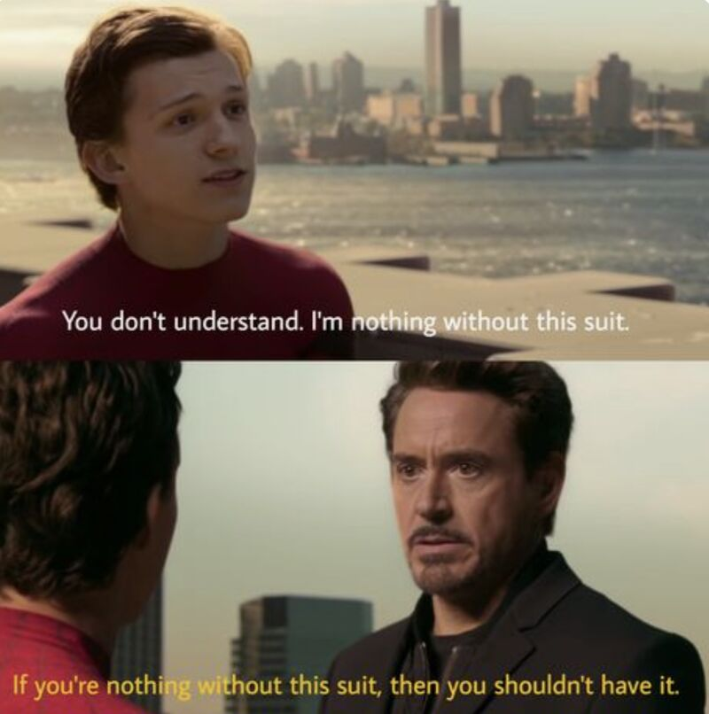
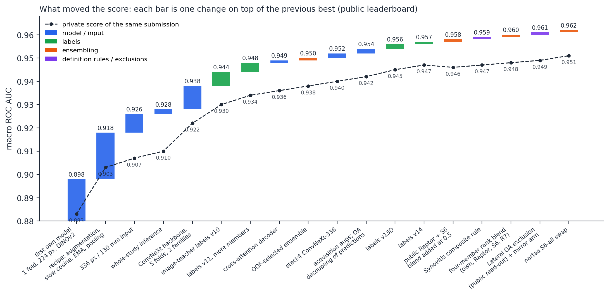
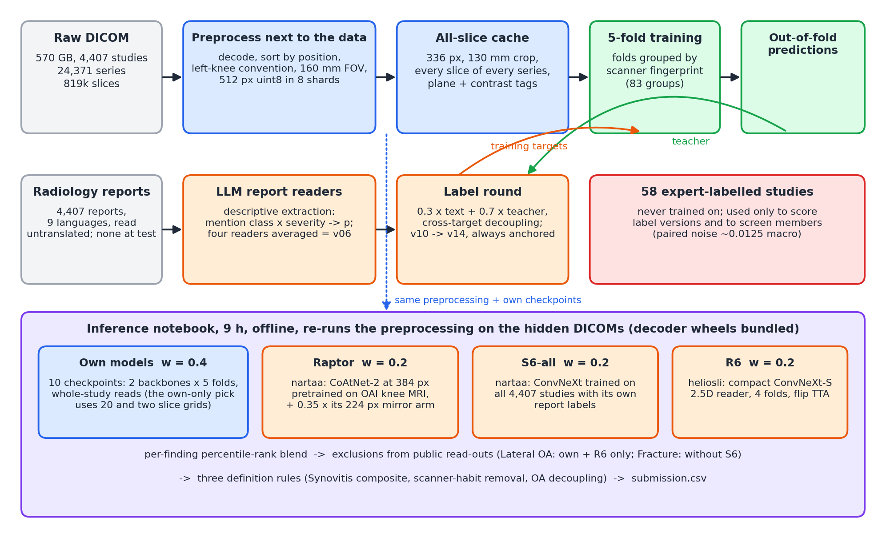
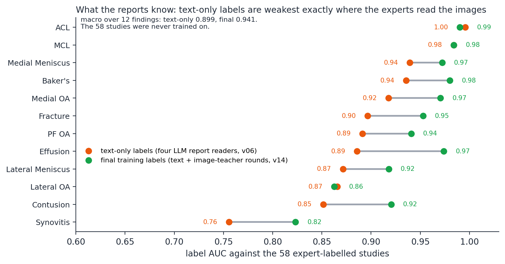
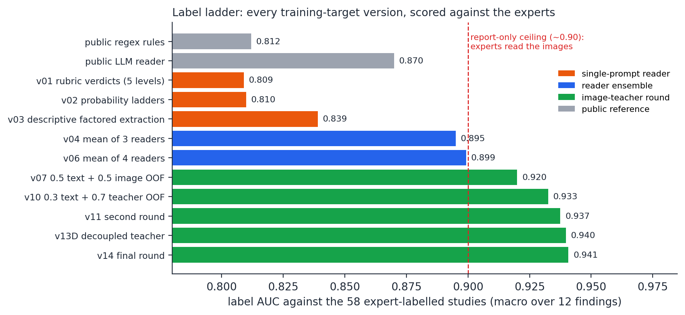
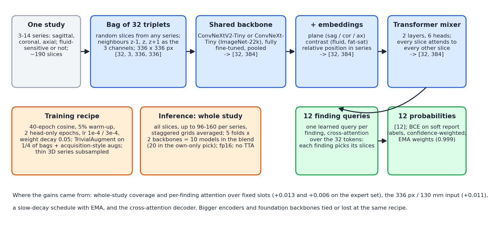
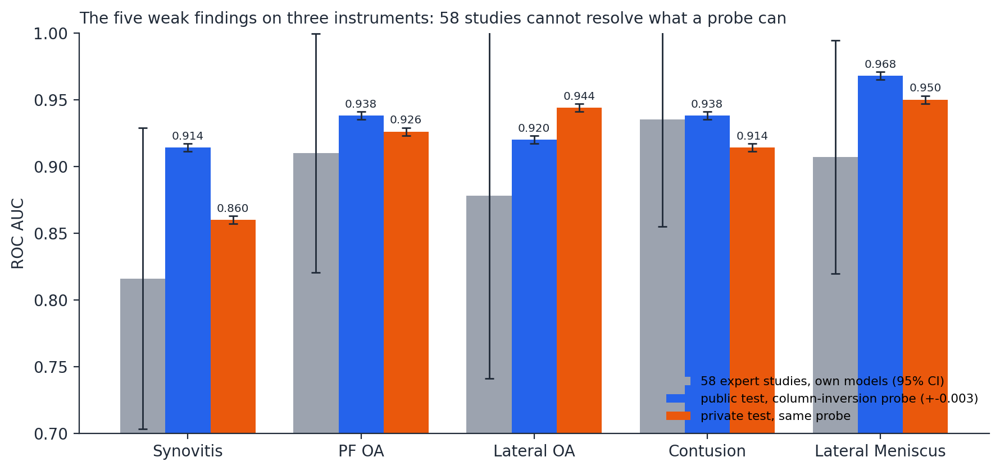
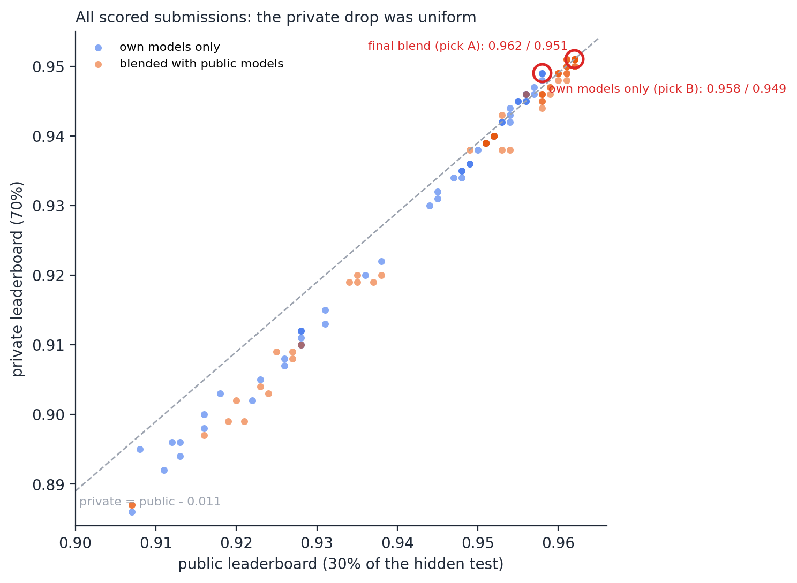
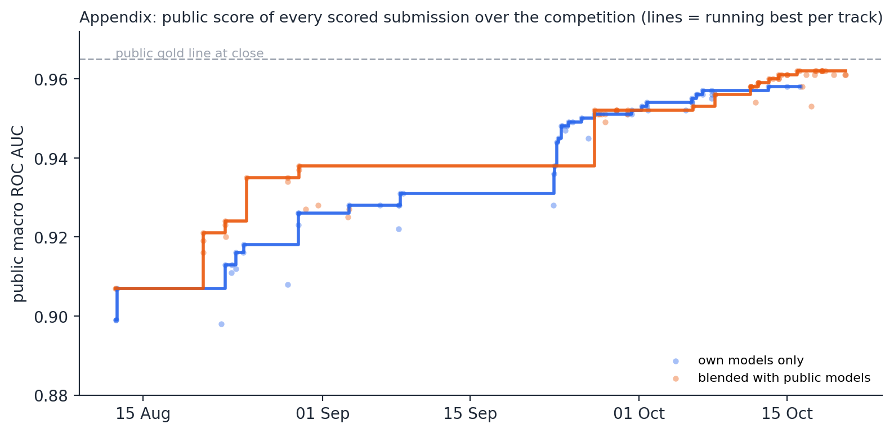

# 49th place (silver, solo): whole-study 2.5D reader + report labels + rank blend

*Public 0.962 / private 0.951, rank 49 of 6,425. What moved the score, a trick to read one finding's public AUC, and all that did not work.*

## TL;DR

Honestly, this one was a grind, so here is the short version before the long story (and the long story is long, you have been warned 🙃).

- **Result.** Solo, 49th of 6,425 teams, silver medal (6th silver btw, and still one gold away from becoming a Competitions Master, but anyways). Public 0.962, private 0.951. My late entries lost 0.009 to 0.012 from public to private and the early single-fold ones 0.015 to 0.019, which is exactly what happened to the whole top of the board too, hence no shake-up for me (a "tick" from here on means 0.001, the last digit Kaggle shows).
- **Two picks, declared upfront.** Pick A is the blend that includes three public models, one of them pretrained on the OAI knee MRI collection: public 0.962, private 0.951, the one that scored. Pick B is my own models only, no external data and no external weights of any kind: public 0.958, private 0.949. I kept B as the safe one in case externally pretrained weights got ruled out (the hosts never answered that question), and btw it would have been a silver on its own too.
- **Model.** A whole-study 2.5D "slice-bag" reader. Every slice of every series is a candidate, a bag of 32 slice triplets goes through a ConvNeXt-Tiny backbone at 336 px over a 130 mm field of view, a small transformer mixes the bag, and twelve learned finding queries read it by cross-attention (one query per finding, so each finding picks its own slices). At test time the model reads the whole study, not a sample of it.
- **Engineering.** 570 GB of DICOM preprocessed right next to the data into sharded caches (an 819,078-slice training cache at 336 px), folds grouped by scanner, and a nine-hour offline inference notebook that re-runs the preprocessing on the hidden studies with a time guard around every single member (one dead member once gave me a constant submission, never again).
- **Labels.** A complete sample here has three parts: the MRI scan, the radiologist's free-text report, and the twelve expert labels. All 4,407 training studies came with the scan and the report, but the expert labels existed for only 58 of them. So either you train on 58 samples (not happening), or you generate the labels for the other 4,349 yourself, from the reports. Now you might say the report gives you nearly exact labels, hence the job is easy. Indeed, except for the twist: you cannot feed the reports to the model as input, because the test data has no reports at all for any sample, only the scans. So the report could only ever be a teacher at training time and never a feature. My targets hence came from four LLM readers producing soft probabilities from the reports (0.899 AUC against the experts), then image-teacher rounds, 0.3 x text + 0.7 x out-of-fold model probabilities, anchored back to the text every round (0.941). This was, honestly, the WHOLE game.
- **Blend.** Per-finding percentile-rank blend: my own models 0.4, nartaa's OAI-pretrained CoAtNet 0.2, nartaa's all-data ConvNeXt 0.2, heliosli's compact ConvNeXt-S reader 0.2, with two per-finding exclusions and three rules I wrote from the expert definitions (Synovitis composite, scanner-habit removal, OA decoupling).
- **The reusable idea.** Resubmit a scored entry with one finding's column inverted and you can read that finding's public AUC to about +-0.003: AUC_f = 0.5 + 6 x (base score - probe score). This replaced the 58 expert studies as my per-finding judge, decided one column exclusion worth a tick and confirmed a second.
- **The lesson.** Honestly, the last +0.004 to gold was never sitting in the models, it was sitting in what the expert graders call synovitis, contusion and osteoarthritis, and the reports simply do not say those things. Reading the images with a multimodal model early, blind of the report, is the thing I would do FIRST next time.

**Contents.** [0. About me, and a retrospect](#0-about-me-and-a-retrospect-on-agents-compute-and-being-a-student-here) | [1. The problem](#1-the-problem-participants-can-skip-this-you-already-know-all-of-it) | [2. What moved the score](#2-what-moved-the-score) | [3. Data pipeline](#3-data-pipeline) | [4. Labels from reports](#4-labels-turning-reports-into-targets) | [5. The model](#5-the-model-a-whole-study-25d-slice-bag-reader) | [6. Ensembling](#6-ensembling-and-the-public-members) | [7. Instruments](#7-instruments-how-i-decided-what-was-real) | [8. What did not work](#8-what-did-not-work) | [9. Final selection and the private board](#9-final-selection-and-the-private-board) | [10. What I would do differently](#10-what-i-would-do-differently) | [11. Credits and reproducibility](#11-credits-and-reproducibility) | [Appendix](#appendix)

---

## 0. About me, and a retrospect on agents, compute and being a student here

Hi, I am Komil Parmar. I am currently a 3rd year undergrad at IIT (Indian Institute of Technology) Guwahati, doing a BSc Honours in Data Science and Artificial Intelligence.

Being just a college student, I am honestly quite proud of myself for this one. Especially because the leaderboard is mostly filled with working professionals, with barely any students on it, and even fewer students from India. And I am happy that I could hold a competitive rank next to some incredible (and frankly scary) teams. For instance, the team at rank 40 is an NVIDIA team with 5 NVIDIA researchers from around the world, and I am sitting 9 places below them with a laptop and a Kaggle account 😅.

With the silver from this competition I now hold 6 silver medals and 3 bronze medals on Kaggle. Hence, one gold medal away from becoming a Kaggle Competitions Master. (Wish me luck for that one.)

For those of you at companies, or with internal projects, I am looking for opportunities in ML and CV. I do not want to dump my whole bio and experience into this discussion, so you can find my contact and bio on my site: https://komil-parmar.github.io/. Feel free to connect with me on LinkedIn as well: [LinkedIn link].

**Now, apart from the solution itself, if there is one thing I want to talk about, it is definitely this agentic era we are in.**

My take: I barely write the code myself anymore. I use Claude most of the time, for preparing docs, writing code, debugging, and lots and lots more. What I do is the thinking, the creativity, the idea generation, deciding what to try next and what to kill, and reading the results properly.

But here is the thing people get wrong. If you leave an agent like Claude unattended and just ask it to do "autoresearch" from scratch on a competition and keep improving autonomously, it will take you nowhere. It is a waste of credits and money, and I say this from experience, not theory. If it somehow gets you even a tick above the highest scoring public notebook, consider yourself lucky.

So agentic engineering, and harness engineering, should be treated as a SKILL that everyone has to learn now. It is not some leverage that one person has over another. A student who is still learning, but harnesses the agents well, can surpass a whole team of agents with unlimited budget left alone to "do research and improve autonomously".

Agents are hands. They can do the hard work, and lots of it. But the smart work still has to be done by your own brain. That is my take, and I am fairly confident about it after these two months.

**Talking about compute budget**, I think it helps, but mostly it helps with concentrated experiments. Think of it like this: say I have a huge compute budget. I can run multiple parallel, continuous, rigorous experiments overnight, 3-4 days back to back, 24/7. BUT, someone who uses 100% of the Kaggle quota from day 1 of the competition till the end gets almost the same total budget, plus the time in between is actually useful, to retrospect deeply and plan what experiments to do next week. That substantially improves the quality of the experiments and maximises your ROI, which you simply do not get when you are running rigorous experiments back to back blindly (I did some of that too, and the ladder in section 2 shows which weeks it was).

That being said, I do have a Colab Pro+ subscription that I use, it comes at around $50 per month, but that is because I do many competitions in parallel, side by side. If you are a student and do not want to spend anything, then focusing and going all in on one competition is what I would recommend.

At last, for all those who say (or quietly think) that resources like a massive budget, agents and compute expenditure are what make teams top, and that this is the reason they themselves cannot get there, I only have one thing to say:

> "If you are nothing without it, you shouldn't have it."

*Yes, that is the Iron Man line, and honestly it fits perfectly here.*

Anyways, that was the retrospect. Now the solution.

---

## 1. The problem (participants can skip this, you already know all of it)

So let me set the scene first. The task looks simple on paper: for every knee MRI study, output twelve probabilities. ACL tear, MCL tear, medial and lateral meniscus tear, medial, lateral and patellofemoral osteoarthritis (OA), effusion, synovitis, Baker's cyst, bone contusion, fracture. The metric is macro ROC AUC over the twelve, and inference runs in a Kaggle notebook with no internet and a nine-hour limit on a hidden test of about 1,300 studies (30% public, 70% private).

Sounds like a normal multi-label imaging competition, right? It is not, because of two twists.

To see them, think of a complete sample as three things: the MRI scan, the radiologist's free-text report about that scan, and the twelve expert labels. First twist, the labels. The twelve findings were graded by two musculoskeletal radiologists plus an adjudicator, from the images, with a published rubric, for only 58 of the 4,407 training studies. Yes, 58. The other 4,349 studies have the scan and the report but no labels, so either you train on 58 samples (not happening) or you make the labels yourself from the reports. The hidden test was graded by the same expert process, so the leaderboard measures agreement with expert image reading. The reports, btw, are in nine languages (Turkish, Croatian, Greek and Bulgarian included, not just English and Spanish).

Second twist, and this is the one that makes the first one hard: the reports do not exist for the test studies at all, only the scans. So you cannot use the report as an input to the model, however tempting that is, because at test time there is nothing to feed it. The report can only be a teacher at training time. The whole game hence becomes: turn reports into training targets that agree with image-reading experts, and then build an image model that never gets to see a report.

The rubric mattered way more than it looked at first. "Small effusion" is negative under it. Marrow oedema next to a fracture line is a fracture, not a contusion. Synovitis is graded from the joint lining and the fluid, and 79% of the reports never even mention it. So a report can contradict the label and still be a perfectly fine report. (This single fact explains most of the second half of this write-up, btw.)

| fact | value |
|---|---|
| training studies / series / slices | 4,407 / 24,371 / 819,078 (570 GB of DICOM) |
| expert-labelled training studies | 58 (1.3%), all twelve findings each |
| report languages | English 1,735, Spanish 681, Turkish 546, Croatian 408, Greek 321, German 263, Bulgarian 220, Dutch 152, other 81 |
| hidden test | ~1,300 studies, no reports, mixed DICOM transfer syntaxes, 30% public / 70% private |
| metric | macro ROC AUC over 12 findings; leaderboard shows three decimals |
| scanners | Siemens ~44%, Philips ~30%, GE ~21%; 61% at 1.5 T; native in-plane resolution median 0.31 mm |
| public baseline at launch | 0.832, a frozen DINOv2-small over six fixed series slots |
| board at close | public #1 0.970, public gold line 0.965; private #1 0.960, private gold line ~0.955 |

*Table 1. Competition facts.*

**How to read the numbers in this write-up.** Three instruments show up everywhere below and each one has a noise floor, so please keep these in mind (I learned them the hard way). The 58 expert studies ("gold-58") have a paired noise of about 0.0125 macro AUC between two models, which means only differences above 0.02 are worth believing there, and per-finding reads on 9 to 35 positives are basically noise. A single training fold of my model family has a seed-to-seed noise of 0.0026, hence I treated 0.005 as the smallest fold-0 difference worth believing. And the leaderboard is deterministic (a byte-identical resubmission scored identically, I checked) but shows only three decimals, so a one-tick change is a direction, not a size. Section 7 goes into how each instrument lies and the probe trick that gets around the 58-study problem.

---

## 2. What moved the score

Figure 1 is basically the whole competition in one picture, so start there. Each bar is one change on top of the previous best public score, and the dashed line is the private score of that same submission. I kept this ladder religiously throughout the competition (a change that is not on it basically did not happen).

*Figure 1. Each bar is one change applied to the previous best; the dashed line is the private score of the same submission. Late entries sit 0.009 to 0.012 below their public score, the early single-fold models 0.015 to 0.019.*

| step | change | public | private | section |
|---|---|---|---|---|
| 1 | first own model: one fold, 224 px, DINOv2-small slice bag | 0.898 | 0.883 | 5 |
| 2 | recipe: augmentation, slow cosine schedule, exponential-moving-average (EMA) weights, per-finding pooling | 0.918 | 0.903 | 5 |
| 3 | 336 px over a 130 mm field of view | 0.926 | 0.907 | 5 |
| 4 | whole-study inference instead of random bags | 0.928 | 0.910 | 5 |
| 5 | ConvNeXt backbones, five folds, two model families | 0.938 | 0.922 | 5 |
| 6 | image-teacher label round (v10) | 0.944 | 0.930 | 4 |
| 7 | second label round (v11), more members | 0.948 | 0.934 | 4 |
| 8 | cross-attention decoder | 0.949 | 0.936 | 5 |
| 9 | ensemble selected on out-of-fold AUC | 0.950 | 0.938 | 6 |
| 10 | four-stage feature stacking in the ConvNeXt backbone | 0.952 | 0.940 | 5 |
| 11 | acquisition-style augmentation recipe; OA decoupling applied to the predictions (0.952 without it) | 0.954 | 0.942 | 5, 6 |
| 12 | label round with a decoupled teacher (v13D) | 0.956 | 0.945 | 4 |
| 13 | final label round (v14) | 0.957 | 0.947 | 4 |
| 14 | heliosli's public blend of Raptor and S6 rank-blended in at 0.5 | 0.958 | 0.946 | 6 |
| 15 | Synovitis composite rule (also +1 tick on the own-only track: 0.957 to 0.958) | 0.959 | 0.947 | 6 |
| 16 | four-member rank blend: own 0.4, Raptor 0.2, S6 0.2, heliosli's reader 0.2 | 0.960 | 0.948 | 6 |
| 17 | Lateral OA scored without Raptor and S6 (public read-out); Raptor's 224 px mirror arm | 0.961 | 0.949 | 7 |
| 18 | nartaa's all-data S6 model in place of the two-fold one | 0.962 | 0.951 | 6 |

*Table 2. The ladder by change. Steps 1 to 4 are single-fold models; from step 5 on, every entry is a five-fold ensemble. The own-models-only track ended at 0.958 (pick B) with the rule of step 15 and scanner-habit removal.*

Three families of changes carried almost everything, and honestly it took me a while to see the pattern. Input geometry and the training recipe took a single fold from 0.898 to 0.928 (steps 1 to 4). Then, of the 0.019 that the five-fold ensemble gained from 0.938 to 0.957, the four label rounds alone contributed 0.013 (steps 6, 7, 12, 13), while the decoder, the ensemble selection, the stacked backbone and the augmentation recipe were worth one tick each (steps 8 to 11). And finally, blending with public models that were trained on different labels than mine, one rule written from the expert definitions, and one exclusion read straight off the public board added the last five ticks (steps 14 to 18). Beyond five folds, more seeds and more folds were invisible, and flip test-time augmentation actually LOST.

The ladder also shows where it all stopped. Nine entries of the final structure displayed 0.962 (the base and eight variants of it), and the three one-change candidates I tried on top of them each lost a tick. Section 9 covers that plateau and what the private board said about it (spoiler: the private board agreed with the plateau, not with me 😅).

---

## 3. Data pipeline

Before any modelling could even begin, there was the 570 GB of DICOM to deal with, and that alone took a while to figure out. You cannot download that to a laptop, and mirroring it to a cloud drive turned out to be a terrible idea too (many small files over a mounted drive is painfully slow, I tried). So I preprocessed it next to the data, in Kaggle CPU sessions, and trained from a compact cache from then on.

*Figure 2. The system. The green loop is the label round: out-of-fold predictions become the teacher for the next training targets. The 58 expert studies never enter training.*

**Preprocessing.** Each series was decoded, sorted by physical position, mapped to a left-knee convention, cropped or padded to a 160 mm field of view and stored as uint8 at 512 px, because 512 px is the median native resolution of a 160 mm crop (516 px to be exact, so storing 384 px would have thrown away detail for more than half the series). Eight sharded runs converted all 4,407 studies with zero failures. Now, the laterality tag exists on only half of the studies, so for the rest I used the sign of the sagittal image position along the patient's x axis, which agreed with the tag in all 29 studies of an audit sample where both existed. Btw, reviewing the first version of this, I caught a bug that would have labelled nearly every tagless study as a right knee: only the sagittal positions carry the side, coronal and axial offsets do not (a bug like that, silently flipping half the medial and lateral labels, would have haunted me for the whole competition).

**The training cache.** From the 512 px store I built an all-slice cache at 336 px over a 130 mm centre crop: every slice of every series, 819,078 of them, each with its plane, its contrast class (fluid-sensitive or not) and its relative position within the series. Series with more than 60 slices (those are 3D acquisitions, up to 320 thin slices) were subsampled to 32 evenly spaced levels so they could not flood a bag. This single cache fed every model from late August till the end, which is one of the few decisions I never had to revisit.

**Folds.** Scanner identity is a shortcut in this data, and a sneaky one. A model that only sees DICOM metadata scores 0.65 macro AUC on random folds and 0.60 on scanner-grouped folds, and random folds inflate any image model's cross-validation by 0.05 to 0.07 because every site has its own case mix and its own reporting habits. Hence I built a scanner fingerprint from manufacturer, model, imaging frequency rounded to the MHz and receive coil (83 groups), and split five folds by group. Every out-of-fold number in this write-up comes from those folds.

**Test-time hardening.** The training DICOMs were all uncompressed, but the test description promised mixed transfer syntaxes, so the notebook bundles offline decoder wheels for JPEG-lossless and JPEG 2000 and decodes per file inside try/except, so a corrupt slice costs one slice and not a study (two corrupt training files that people reported on the forum were already handled this way). Every member of the blend runs in its own stage with a time guard, and the blend renormalises over the members that finished, so a slow member cannot turn a submission into a constant. Not glamorous, but this is the stuff that keeps you from scoring 0.500 on the final day.

---

## 4. Labels: turning reports into targets

This section is the imp one. Honestly, everything else in this write-up is just engineering around what is in here.

**What the final labels are.** Each training study got a soft probability per finding, built from what its report says and from what my own models saw in its images. For each study and finding, the training target was

`y = 0.3 x text + 0.7 x teacher`

where *text* is the mean probability of four LLM report readers (label set v06) and *teacher* is the out-of-fold (OOF) probability of the current five-fold image ensemble, meaning the prediction each model makes for the studies it did not train on, with the medial OA probit subtracted at weight 0.15 from the teacher's lateral and patellofemoral OA probits before mixing ("decoupling"; section 6 applies the same idea to predictions). "Anchored" means every round mixes back to the same text labels, never to the previous round's targets, so the loop cannot drift away from the reports. Teachers only ever saw training studies; no test prediction was ever used as a label. And the 58 expert studies were never trained on at any point, they only scored label versions and screened members.

*Figure 3. What the reports know. Text-only labels are weakest exactly where the experts read the images: synovitis, contusion, lateral osteoarthritis, lateral meniscus, effusion. The image-teacher rounds lift most findings; lateral OA barely moves.*

**Six things I learned about report labels** (lots and lots of failed attempts behind each one of these):

- **Describe, do not diagnose.** My very first prompt asked a 32B open model to apply the rubric and output a five-level verdict per finding. It scored 0.809 against the experts, which is BELOW the public regex baseline, and I remember staring at that number for a while 🤔. The reason was that the verdict quantisation collapsed the ranking: a grade-2 MCL sprain and a pristine ligament both landed at 0.03. So instead I asked the model to *describe* what the report states, a mention class (not mentioned / explicitly normal / minor / present) times a severity grade, with the probability assigned in code from that pair (explicitly normal 0.03, not mentioned 0.15, minor 0.40, present at severity 0 to 1, 2 and 3 as 0.62, 0.80 and 0.95). Same model family, 0.839, and the ligaments were fixed outright (ACL 0.95, MCL 0.98).
- **Not mentioned is not normal.** Keeping "explicitly normal" and "not mentioned" as two separate states, and giving silence a low but non-zero probability, was worth more than any wording change I ever made to a prompt.
- **Readers average well.** Two of my readers (Qwen2.5-32B, its 0.872 run, and Qwen3-32B, both run locally) plus the best public LLM label set gave 0.895 as an equal-weight probability mean, against 0.87 for the best single reader. A fourth reader, a hosted Claude Sonnet pass with the same descriptive schema, took it to 0.899 (v06). Reports were read untranslated in all nine languages, and this matters, because language-specific negation (Turkish puts the negation after the term, for example) is one reason a regex approach stays stuck at 0.81.
- **Decoding is not run-stable.** Identical prompts at temperature zero scored 0.810 and 0.872 on the same 58 studies in two batch configurations of the same model (yes, same model, same prompt, same studies). Hence I treated +-0.02 of label AUC as noise and never tuned a prompt on per-finding changes at n = 58, however tempting it was.
- **The report-only ceiling is about 0.90.** Every reader, mine or public, saturated near 0.90 against the experts. Why? Because the experts read the images, and the report author did not write the report for a grader. Synovitis (0.76 text-only) is the extreme case: 79% of the reports are silent on it, and the mention rate varies from 0.8% to 64% by scanner, which is a reporting habit of the site, not disease. I even trained a text classifier distilled from the four readers, and it scored 0.885, and exactly chance on the cells where the readers disagreed. Reading the same reports again and again cannot add anything new, so the only place left to get the information from was the images themselves.
- **Image teachers work once the teacher beats the labels, and then they saturate.** The first fold-0 model's out-of-fold predictions mixed 50/50 into the text labels lifted the label AUC from 0.899 to 0.920 (v07), and I was quite excited. Retraining on v07 did not move the model though, and a second such round tied again (two rounds, two ties, I nearly gave up on the idea). The rounds started paying only when the five-fold ensemble was actually better than the labels it was trained on: v10 (0.3 text + 0.7 teacher) gave +0.006 on the leaderboard with the exact same models, v11 gave +0.003, and v12 gave nothing, because teachers that all descend from one text lineage converge on the same errors. The last two rounds (v13D, v14) added the OA decoupling to the teacher and gave +0.003 and +0.001 in matched pairs.

| version | method | label AUC vs experts | verdict |
|---|---|---|---|
| public regex rules | keyword rules over reports | 0.812 | reference |
| public LLM reader | hosted API, soft quantised scores | 0.870 | reference, bar to beat |
| v01 | rubric verdicts, five levels, Qwen2.5-32B | 0.809 | rejected, rank collapse |
| v02 | 0-100 probability with severity ladders, Qwen2.5-32B | 0.810 (0.872 in a second run) | component |
| v03 | descriptive factored extraction, Qwen3-32B | 0.839 | component |
| v04 | probability mean of v02, v03 and the public LLM set | 0.895 | first training set |
| v06 | v04 plus a Claude Sonnet descriptive reader, four-reader mean | 0.899 | text anchor for all later rounds |
| v07 | 0.5 text + 0.5 fold-0 image OOF | 0.920 | label better, model tied |
| v08 (text) | XLM-RoBERTa + LaBSE trained on reader consensus | 0.885 | rejected |
| v10 | 0.3 text + 0.7 five-fold ensemble OOF | 0.933 | +0.006 public |
| v11 | second round from the v10 bank | 0.937 | +0.003 public |
| v12 | third round, eight-family teacher | flat | saturated, +0.000 |
| v13D | v11-style round with probit decoupling of the OA columns | 0.940 | +0.003 public (matched pair) |
| v14 | final round from the v13D bank | 0.941 | +0.001 public, final targets |

*Table 3. Label versions. Every version was scored against the 58 expert studies before any model trained on it; the verdict column is the matched leaderboard test where one exists.*

*Figure 4. The label ladder. Prompt design moved the readers from 0.81 to 0.84, ensembling them to 0.90, and only the image-teacher rounds crossed the report-only ceiling.*

### 4.1 Why report-derived validation lies, and the audit that measured it

Here is a trap I fell into once and then measured properly. A model trained on teacher labels and validated against report-derived labels on the same folds looks better than it really is, because the teacher that wrote its targets has already seen the validation fold. So I sealed a fold: fold 3 was held out of every teacher, and students were trained on text-only labels, on teachers fitted strictly inside the other folds, and on the leaky global teacher. The clean gain of one label round came out at +0.004 on report-derived validation and +0.016 on the expert studies; the leaky setup showed +0.011 on report-derived validation, which is about three times the real effect. From then on, any arm whose labels came from a teacher was judged on the leaderboard or on the sealed fold only, no exceptions (which made every label experiment slower, yes, but at least I stopped fooling myself).

---

## 5. The model: a whole-study 2.5D slice-bag reader

The public baseline at launch, and the whole fork tree built on top of it, read six fixed series slots with nine slices each. That always bothered me, because a meniscal tear does not care which nine slices you picked. So my pipeline reads the whole study.

*Figure 5. The slice-bag reader. A bag of 32 slice triplets from any series is encoded, tagged with plane, contrast and position, mixed by a two-layer transformer and read by twelve learned finding queries.*

**How it reads a study.** Training samples a bag of 32 slices per study from any series. Each slice becomes a 2.5D triplet with its physical neighbours (z-1, z, z+1) as the three channels, so a tear that lives on two adjacent slices is seen together. A shared ConvNeXt backbone encodes each triplet into a 384-dimensional token, and the token gets learned embeddings for its plane (sagittal, coronal, axial), its contrast class (fluid-sensitive or not) and its relative position within the series. A two-layer, six-head transformer then mixes the bag, so a sagittal slice can attend to the coronal slice at the same level. And finally twelve learned queries, one per finding, read the bag by cross-attention: an attention-based multiple-instance head where each finding chooses its own slices (think of it as twelve people reading the same book, each one only looking out for their own character). Twelve logits come out, trained with binary cross-entropy against the soft labels, weighted by label confidence.

**How it reads at test time.** Inference does not sample bags at all. It reads every slice of the study, up to 96 to 160 per series on a fixed grid, in one deterministic pass. Against the training-time protocol (four random bags averaged), this whole-study read was worth +0.009 on the expert studies at 336 px; on the board it was worth one to two ticks, because the windowed inference I had used before already covered most of each study. Against the original six-slot design, whole-study coverage with resampling and the per-finding decoder were worth +0.013 and +0.006 on the expert studies. For the own-models-only entry I also averaged two slice grids offset by half a step, which added about +0.0003 per model on out-of-fold AUC (tiny, but free).

**The geometry story.** The first version of this reader, at 224 px with a frozen-then-tuned DINOv2-small, scored 0.898 with one fold on the leaderboard, which was already above my five-fold slot model (one fold beating five, that was the moment I knew the geometry was the thing). Augmentation (TrivialAugment on a quarter of the bags), a slower cosine decay, EMA-evaluated checkpoints and per-finding pooling took one fold to 0.918. Then I spent a full week measuring eleven families of levers at 224 px: auxiliary heads for geometry, severity and report text, report-contrastive pretraining, consistency-based semi-supervision, attention masking, focal pooling, searched augmentation policies, a bigger DINOv2, longer schedules, warm restarts and sample weighting. Every single one of them tied or lost on fold-0 report-derived validation against the 0.005 seed-noise threshold, with the expert studies as a veto. A whole week, eleven ideas, zero adoptions 🤦‍♂️. The only lever that cleared the bar was the input itself: 336 px over a 130 mm crop gave +0.011 on the expert studies, the first and only adoption-sized gain from a single change in the entire competition, and 0.926 solo on the board. At the new input, a 448 px cache gave nothing more.

**Backbones.** Swapping the DINOv2 backbone for ConvNeXt-Tiny (ImageNet-22k weights, fully fine-tuned) was flat on the expert studies and equal-best on the leaderboard, and this was the first place I learned that the 58 studies mis-rank across model families (more on that in section 7). Two families (ConvNeXt-Tiny and ConvNeXtV2-Tiny) blended better than seeds of one. CoAtNet, EfficientNetV2 and a DINOv2 at 336 px were trained as extra families and dropped when they added nothing to the out-of-fold ensemble. Foundation backbones lost, which honestly surprised me at first: a frozen DINOv3-H+ gives a decoder ceiling of 0.826 against 0.907 for a trained small model's frozen features, and DINOv3 fine-tuned at the ConvNeXt learning rate underperformed until its own learning rate was tuned, at which point it came level with the incumbent and was closed as no better. SigLIP transferred worse than DINOv2. And a bigger backbone at the same recipe never won, not once in the whole competition, which took me a while to accept.

**Three decoder-side gains.** A cross-attention decoder in place of plain attention pooling gave +0.0025 on fold-0 validation and +0.001 on the board. Stacking the four stage outputs of the ConvNeXt backbone ("stack4") before the mixer gave +0.001 on five folds and became the efficiency-track family. An acquisition-style augmentation package (affine jitter, resolution degradation with re-upsampling, reconstruction-like noise and sharpness changes) became the parent recipe of the final models after a long series of paired recipe comparisons.

| component | final setting |
|---|---|
| backbones | ConvNeXtV2-Tiny (fcmae, in22k-in1k) and ConvNeXt-Tiny (in22k-in1k), fully fine-tuned |
| input | 336 px, 130 mm centre crop, 2.5D triplets of physical neighbours, uint8 |
| bag | 32 triplets per study, sampled uniformly over all slices of the study; two studies per batch with two accumulation steps; thin 3D series subsampled to 32 levels |
| tokens | 384-d, plane + contrast + relative-position embeddings |
| mixer / head | 2-layer 6-head transformer; 12 learned finding queries with cross-attention (attention-MIL) |
| loss | BCE on soft labels (v14), each cell weighted 0.3 + 0.7 x abs(2p - 1) so confident labels count more |
| optimiser | AdamW, backbone lr 1e-4, head lr 3e-4, weight decay 0.05, 5% warm-up, 2 head-only epochs |
| schedule | 40 epochs, cosine decay to 1.5% of the peak rate, EMA 0.999 evaluated and saved |
| augmentation | TrivialAugment on 25% of bags; affine, resolution-degrade and reconstruction-noise package; no left-right flip |
| folds / seeds | 5 scanner-grouped folds; two seeds for the own-only entry |
| inference | whole study, up to 96-160 slices per series, fp16, no flip TTA; two staggered grids in the own-only entry |

*Table 4. The final recipe for the own models.*

---

## 6. Ensembling and the public members

**Own models.** Ten checkpoints entered the final blend: two backbones times five folds, trained on the v14 labels. The own-models-only entry (pick B) used twenty checkpoints from four groups (a second seed and a sibling recipe added) and two slice grids. Within the own group, probabilities were averaged per backbone, then rank-averaged across backbones. Seeds and folds beyond that were invisible on the board, but I kept them anyway for the private set (variance reduction cannot hurt, it just cannot show at three decimals).

**Public members.** Here is where I have to be honest about something. By early October my own models were stuck at 0.957, and three public models existed that were trained on supervision I simply did not have. nartaa's "Raptor" is a CoAtNet-2 at 384 px whose weights were pretrained on the Osteoarthritis Initiative knee MRI collection and then fine-tuned on this competition's reports with its own label pipeline; it scored 0.949 alone. Inside its slot I mixed 0.35 of its 224 px mirrored sibling, which an expert-study screen had called +0.003 and which the board confirmed as no worse. nartaa's S6-all is a ConvNeXt trained on all 4,407 studies with its report labels, 0.950 alone. heliosli's R6 is a compact ConvNeXt-S 2.5D reader with graded report-state heads, four folds with flip test-time augmentation, the core of the best public notebook (0.958). The weights were fixed before any submission at 0.4 for my models and 0.2 for each public member, and btw moving my share anywhere between 0.4 and 0.6 did not change the displayed score at all.

Think of it like asking four doctors who trained at four different hospitals. The four opinions only help because each one learnt different things, and asking the same doctor four times (which is basically what more seeds are) adds nothing however many times you ask.

**The blend, per finding f:**

`s_f = sum over included members m of w_m x pctrank(p_{m,f})`

where `pctrank` is the percentile rank of a member's probability over all test studies, computed separately for each finding, and the included set excludes two member-finding pairs: Lateral OA is scored by my models and R6 only, and Fracture without S6. The Lateral OA exclusion came from a public read-out and the Fracture exclusion from the expert-set screen, confirmed on the board (section 7).

**Three rules from the expert definitions**, applied after the blend to the ranked columns:

1. *Synovitis composite.* `Syn <- rank( rank(Syn) + 1.0 x rank(Effusion) + 0.75 x mean(rank(MedOA), rank(LatOA), rank(PFOA)) )`. On the expert studies, synovitis is positive in 15 of 21 knees with both an effusion and osteoarthritis, and in 1 of 15 knees with neither. So the experts are really grading effusion-synovitis, while the reports mostly stay silent. This rule was predicted by the expert studies (+0.036 on that finding) while report-derived validation rejected it (of course it did, the report labels have the wrong definition), and it gave +1 tick on the board on two different bases.
2. *Scanner-habit removal.* `Syn <- rank( rank(Syn) - 0.3 x rank(h) )`, where `h` is the mean text-label Synovitis probability of the training studies with the same scanner fingerprint, shrunk toward the global mean (k = 20), and the global mean for a fingerprint not seen in training. The fingerprint comes from the allowlisted DICOM header fields that every notebook reads. This removes the part of the Synovitis score that tracks a site's reporting habit rather than the knee.
3. *OA decoupling.* `LatOA <- rank(LatOA) - 0.15 x rank(MedOA)` and the same for PF OA. The models score lateral and patellofemoral osteoarthritis by context, not by compartment: lateral OA against medial-OA-only knees has an AUC of 0.73 on the report labels, and the three OA columns of every member are strongly coupled. The same decoupling, applied to the teacher before the last two label rounds, is what v13D and v14 added.

| entry | change vs the previous row | public |
|---|---|---|
| own 20 models, plain rank mean | the own-models ceiling | 0.957 |
| + Synovitis composite, own models only (the pick-B track; scanner-habit removal added later was flat) | definition rule | 0.958 |
| own 20 models + heliosli's public blend of Raptor and S6 at 0.5 | second family, any weight from 0.4 to 0.6 | 0.958 |
| + Synovitis composite | definition rule, one column changed | 0.959 |
| four-member rank blend: own 0.4, Raptor 0.2, S6 two-fold 0.2, R7 two-fold 0.2 (R7 is heliosli's earlier reader; S6 two-fold is the version of S6 in the public notebook) | structure | 0.960 |
| + Raptor-224 mirror arm, Lateral OA without Raptor and S6 | public read-out of that column | 0.961 |
| + scanner-habit removal, OA decoupling | definition rules | 0.961 |
| S6 two-fold replaced by nartaa's S6-all | stronger member, different labels | 0.962 |
| R7 replaced by R6, then R6 all four folds | stronger sibling; averaging | 0.962 |
| eight further variants: more folds, two slice grids, extra own lineages, R6 + R7 | averaging | 0.962 |
| Raptor's share on Synovitis and PF OA raised, or removed | re-weighting | 0.961 |
| public members removed from Lateral Meniscus, R6 from Fracture (expert-study prunes) | pruning | 0.961 |
| blends with weights or prunes fitted to the expert studies | fitted | 0.953 to 0.961 |

*Table 5. The blend ladder and the plateau. Only three kinds of change ever moved the board after 0.957: a strong member trained on different labels, a rule written from the expert definitions, and an exclusion confirmed by a public read-out.*

| stage | members | reads per study | precision | approximate share of the nine hours |
|---|---|---|---|---|
| preprocessing | decode, sort, left-knee, crop | all slices | CPU, overlapped with GPU stages | ~1 h |
| own models | 10 checkpoints | up to 96 slices per series | fp16 | ~2 h |
| Raptor + 224 mirror | 1 + 1 checkpoints | 96 slices, mirror TTA | fp16 | ~1 h |
| S6-all | 1 checkpoint | its own windows | fp16 | ~0.5 h |
| R6 | 4 folds + flip | its own windows | fp16 | ~2.5 h |
| blend, rules, CSV | - | - | CPU | minutes |

*Table 6. Inference time by stage. The final notebook finished in about seven of the nine hours; each stage runs as its own process with a time guard and the blend renormalises over the members that finished.*

---

## 7. Instruments: how I decided what was real

### 7.1 Reading one finding's public AUC with a column-inversion probe

This is the one idea from this competition that I will carry to every competition from now on, so let me explain it properly.

The 58 expert studies cannot tell you which finding you are losing on. With 9 to 35 positives per finding, the 95% interval of a single AUC there is +-0.05 to +-0.15 wide (at that width you might as well flip a coin, honestly). The public leaderboard, on the other hand, can tell you, and it costs one submission per finding.

Take a scored submission with macro score `S`. Replace one finding's column by its negation (`1 - p`) and resubmit. That finding's AUC becomes `1 - AUC_f`, the other eleven stay exactly the same, and the macro mean moves by `(1 - 2 x AUC_f) / 12`. Hence

`AUC_f = 0.5 + 6 x (S_base - S_probe)`

The leaderboard displays three decimals, so each of the two scores carries +-0.0005 and the read-out carries +-0.003 typically and +-0.006 at worst, on roughly 400 expert-graded public studies instead of 58. A change of +0.03 on one finding is +2.5 ticks of macro score, so such reads are decidable where the 58 studies are hopeless.

*Figure 6. The same five findings on three instruments. The 58-study intervals (grey) span most of the axis; the probes (blue, orange) resolve a few thousandths. The private split was harder on Synovitis and Contusion and easier on Lateral OA.*

Two decisions came out of it. On my own models alone, Lateral OA read 0.930 on the public split; on the four-member blend it read 0.920. So the public members, strong almost everywhere else, were pulling that one column DOWN, and scoring Lateral OA from my models and R6 only gave +1 tick. The Fracture column told the opposite story for a different member: nartaa's S6 scored 0.90 on that finding against 0.98 for my models on the expert set, and excluding it held on the board. The same probes, re-read after the deadline on the private split, are the only per-finding private numbers I have, and section 9 uses them.

A note on legitimacy, because I know this looks like leaderboard probing. Each probe is an ordinary scored submission inside the daily allowance and reads the public split only. The probes informed one column exclusion inside pick A; the picks themselves were chosen by a simplest-variant rule, not by probe reads. It is basically reading your own score per finding instead of overall, that is all.

### 7.2 The other instruments and how each one lies

| instrument | what it measures | noise | how it lies |
|---|---|---|---|
| 58 expert studies | agreement with the graders | paired macro ~0.0125; per finding +-0.05 to +-0.15 | mis-ranks across model families; anything chosen on it over-promises about four-fold; per-finding reads are noise |
| report-derived out-of-fold AUC (~880 studies per fold) | ranking of same-label changes | fold-0 seed noise 0.0026 | wrong definition for synovitis, OA, contusion; inflated three-fold for teacher-derived labels; the epoch selector stops tracking the experts after about 27 epochs (validation keeps rising while the expert-study score falls, because both validation and targets are report-derived) |
| sealed fold 3 | clean effect of teacher rounds | one fold | one number per audit, slow |
| public leaderboard, macro | the test distribution | deterministic; display +-0.0005 | one tick is direction only; a 0.0003 gain cannot show |
| column-inversion probe | one finding's public AUC | +-0.003 | one submission per finding; public split only |
| rank within the displayed block | sub-tick movement | fixed teams only | needs a snapshot before and after each submission |

*Table 7. Instruments. Every adoption needed two of them to agree, and a rule for accepting or rejecting was written before the submission was made.*

Two of those rules rejected results I really wanted to keep. An arm that paired each slice with its other-contrast neighbour as extra tokens scored +0.005 on both local instruments and then lost 0.003 on the board. Rejected, and it taught me that the expert studies and the report-derived validation share rows and are not independent of each other (two instruments agreeing is not two votes if they looked at the same studies). Late in the competition, pruning the public members from Lateral Meniscus and R6 from Fracture looked positive on the expert studies; the pre-registered rule was "adopt only if the displayed score rises", it fell by a tick, and the prune was dropped the same morning. And every blend that fitted weights or exclusions to the 58 studies lost on the board, by one to nine ticks, every single one of them (58 rows just cannot fit twelve weights, as Table 8 also says).

---

## 8. What did not work

I believe the failures are at least as useful as the wins (most of my posts are about failures anyways), so here is the full list with the instrument and the comparator for each.

| group | idea | instrument and comparator | measured effect | why, in one sentence |
|---|---|---|---|---|
| labels | trained text classifier (XLM-R + LaBSE) distilled from the four readers | expert studies vs v06 | 0.885 vs 0.899; chance on disagreement cells | re-processing the same reports cannot add information |
| labels | independent public label sets as extra teachers | expert studies, out-of-fold | rank correlation 0.73 to 0.77 with my labels; lower on the expert studies alone and blended | noisier readers of the same reports |
| labels | confident-learning mask on 602 contradicted cells | expert out-of-fold, same recipe | 0.936 to 0.933 | the obvious noise was already fixed by the teacher rounds |
| labels | positive-unlabelled loss for Synovitis | expert out-of-fold | 0.818 to 0.789 on that finding | silence is not a usable negative |
| labels | per-finding label variants (site-habit removed, contusion re-coded, gold anchors) | matched board pairs | 0 for 5 | the model already extracts what the images show |
| model, 224 px | eleven lever families: auxiliary heads, report-contrastive pretraining, consistency SSL, attention masking, focal pooling, searched augmentation, bigger DINOv2, longer schedules, warm restarts, sample weights, curricula | fold-0 report-derived validation, seed-noise threshold 0.005, expert studies as veto | all ties or losses | the input was the ceiling, not the recipe |
| model | 448 px cache | expert studies vs 336 | tie | density beyond 336 px adds nothing at this crop |
| model | flip test-time augmentation | board, same checkpoint | -0.006 | the knees are already canonicalised; flipping swaps compartments |
| model | SWA, SAM, asymmetric loss, AUC fine-tune, gated MIL, learnable pooling, weight-decay sweeps | fold-0 report OOF, seed-paired | all within +-0.001 | the plateau is the labels |
| model | in-domain masked-image pretraining (SimMIM) | report OOF vs ImageNet init | -0.008 | the fine-tune never recovers the ImageNet features |
| model | SigLIP, DINOv3 at the incumbent learning rate, frozen DINOv3-H+ | fold-0 | -0.01, -0.03, ceiling 0.826 | adaptation hyperparameters, not representation, decide the gap |
| model | 3D through-plane branch; centre zoom; a vision-language model fine-tuned to read the images | fold-0 / board | 0 / 0 / 0.89 | the 2.5D triplets already carry the depth that matters |
| model | mixup, early-learning regularisation, anti-ensemble decorrelation, a 38-field report auxiliary head | add-one gain to the ensemble over five folds against a second seed of the same recipe, same label leak on both sides | -0.0006 to -0.006 | same labels produce the same ranking, or a damaged copy |
| model | compartment readers (medial, lateral, patellofemoral tiles) | out-of-fold, add-one | rank correlation above 0.97 with the whole-knee models; add-one gain inside noise | the backbone already localises |
| blend | per-finding weights or exclusions fitted to the expert studies; stackers | board vs equal rank mean | -0.001 to -0.009; stackers below the plain mean on the expert set itself | 58 rows cannot fit twelve weights |
| blend | bag-level distillation of the ensemble into one model | matched board pair | -0.001 (its +0.0076 validation was leak) | the validation labels came from the teacher |
| blend | more seeds, full-data refits, 25% more training data per member | board | 0.000 | invisible at three decimals, kept for private |

*Table 8. Negative results. "0" means inside the instrument's noise, not exactly zero.*

---

## 9. Final selection and the private board

By the last week, nine entries of the four-member structure displayed 0.962, the base and eight variants, within about 0.00014 of each other (bounded by the positions of other teams between my leaderboard snapshots and by the order of entries on the submissions page). No instrument I had could rank them, and the three one-change candidates built on top of them each lost a tick. So what do you do when the board cannot tell your entries apart? I selected the simplest and most averaged variant (R6 with all four folds, no other change) as pick A, and the own-models-only entry (0.958 public, no external weights of any kind) as pick B, as a hedge against two tail risks: a ruling against externally pretrained weights, and the public members fitting the public split.

*Figure 7. Every scored submission, with the column-inversion probes excluded by design (they score 0.88 to 0.89). Late entries lost 0.009 to 0.012 from public to private, own-only and blends alike; the early single-fold models lost more; the two picks are circled.*

**What the private board said.** Pick A scored 0.951, pick B 0.949 (so the clean, no-external-data entry would have landed inside the silver zone on its own, which is exactly why I kept it). Every 0.962 variant and every 0.961 one-change candidate scored the same 0.951, so the fourth-decimal order I agonised over on the final day changed absolutely nothing (I did agonise, btw, for a good hour 😅). The drop was uniform across the board: the public leader at 0.970 finished seventh at 0.957, and the private winner scored 0.960. Private gold needed about 0.955: a gap of +0.004, against +0.003 to the public gold line at close.

**Evidence from the probes on the private split.** Re-read after the deadline, the same inversion probes give the private AUC of five findings (Figure 6): Synovitis 0.860 against 0.914 public, Contusion 0.914 against 0.938, Lateral Meniscus 0.950 against 0.968, PF OA 0.926 against 0.938, Lateral OA 0.944 against 0.920. Those five account for about 0.007 of the 0.011 macro drop. **My inference** (and I might be wrong here, these are five probe reads, not a measurement): the private split was harder on exactly the findings whose expert definitions depart furthest from the reports, and the remaining gap to gold was in the labels for those findings, not in the models. The write-ups of the teams above me that I have read so far point the same way: their single biggest gains were multimodal reads of the images used as labels, anatomy-anchored crops, and a site bias used only in training.

---

## 10. What I would do differently

- **Measure every instrument's noise before trusting a delta from it.** The two numbers that governed my decisions (0.0125 for the expert studies, 0.0026 for a fold) were measured in the first two weeks and saved me from a dozen false adoptions. The one instrument I did not measure early enough was the per-finding public read-out; it existed from day one and I only used it in the last ten days (this one still hurts 🥺).
- **Labels before models, and images before text.** Everything model-side above 0.93 was worth a tick; every honest label gain was worth two to six. The reports have a ceiling near 0.90 against image-reading experts and no reader of mine or anyone else's got past it. A multimodal model reading knee-cropped slice montages, blind of the report and merged with the text labels, is the one thing I never got to and really should have.
- **Pick the simplest averaged variant and stop.** When the board cannot rank your entries, the fourth decimal is just noise, and the private set went ahead and proved it by giving every one of them the same 0.951 (so all that agonising was for nothing).
- **Write the accept rule before the submission.** It is the only thing that stopped me from adopting results that looked good on 58 studies and lost on 400. Not totally fool-proof, but close.
- **Two cheap levers reported by others that I would test first next time:** an anatomy-anchored crop per series instead of a fixed centre crop, and a learned per-site bias used only during training and dropped at test time.

---

## 11. Credits and reproducibility

**Public components in pick A.** Huge thanks to their authors, this blend does not exist without them.

- nartaa: the Raptor CoAtNet (`nartaa/rsna-knee-publication-swa-weights-20261007`, 384 px SWA weights; the 224 px mirrored sibling in `nartaa/rsna-knee-raptor-alldata-d96-blendjev-oai-c08r224`) and the S6 all-data ConvNeXt (`nartaa/rsna-knee-s6fall-weights`), described in the discussion "Reaching 0.949 with one CoAtNet: labels, native crops, and anatomical mirroring". The Raptor weights were pretrained on the Osteoarthritis Initiative collection; my own models and pick B contain no external knee data.
- heliosli: the R6 compact ConvNeXt-S reader (`heliosli/rsna-knee-r6-frozen-fe055406-w1`, used through a private mirror because the dataset was unversioned) and the per-finding blend notebook that reached 0.958.
- pilkwang: the public LLM label set that was one of the four readers in v06, and whose labeller code taught me descriptive extraction (a genuinely imp lesson, see section 4).
- tonylica: the 0.832 launch notebook whose slot design and laterality handling I started from.
- The hosts, for the rubric thread and for patiently answering the questions about reports, labels and external data. 🙏

**Rules.** No test report exists and none was used. All external weights are public Kaggle datasets. Scanner fingerprints at test time come from the allowlisted DICOM header fields.

**Reproducibility notes.** Scanner fingerprint = manufacturer (collapsed spellings) | model name | imaging frequency rounded to the MHz | receive coil; software version dropped; 83 groups over 4,407 studies; patient grouping was not possible because no patient identifier exists. Decoder wheels bundled offline: pylibjpeg, pylibjpeg-libjpeg, pylibjpeg-openjpeg, python-gdcm. The preprocessing, training and inference code: https://github.com/komil-parmar/rsna-knee-2026-49th-place (Apache-2.0). The label files (text readers v04 and v06, final v14, and the scanner-grouped folds): https://www.kaggle.com/datasets/komilparmar/rsna-knee-2026-labels-49th-place. The checkpoints behind both picks are public Kaggle Models: [rsna-camp-v14-a57](https://www.kaggle.com/models/komilparmar/rsna-camp-v14-a57), [rsna-camp-v14-4a0c](https://www.kaggle.com/models/komilparmar/rsna-camp-v14-4a0c), [rsna-camp-v14-a57s2000](https://www.kaggle.com/models/komilparmar/rsna-camp-v14-a57s2000) and [rsna-camp-v14-8bd0](https://www.kaggle.com/models/komilparmar/rsna-camp-v14-8bd0).

If you actually made it all the way down here, do let me know in the comments, it would honestly make my day. And if you are the one who figures out the synovitis labels next time, please do tell me how 😄. See you in the next one (I have not decided which competition yet, suggestions welcome)!

---

## Appendix

*Figure A. Public score of every scored submission over time, probes excluded. Blue: own models only; orange: blended with public models; lines are the running best per track. The own-only track plateaued at 0.957 to 0.958 a week before the blend did.*

| finding | own models | Raptor (+224) | S6-all | R6 | public probe | private probe |
|---|---|---|---|---|---|---|
| ACL | 0.980 | 0.969 | 0.989 | 0.996 | - | - |
| MCL | 0.948 | 0.955 | 0.966 | 0.964 | - | - |
| Medial Meniscus | 0.948 | 0.981 | 0.960 | 0.971 | - | - |
| Lateral Meniscus | 0.907 | 0.892 | 0.935 | 0.916 | 0.968 | 0.950 |
| Medial OA | 0.969 | 0.981 | 0.981 | 0.991 | - | - |
| Lateral OA | 0.878 | 0.779 | 0.851 | 0.865 | 0.920 | 0.944 |
| PF OA | 0.910 | 0.861 | 0.902 | 0.916 | 0.938 | 0.926 |
| Effusion | 0.986 | 0.981 | 0.949 | 0.945 | - | - |
| Synovitis | 0.816 | 0.815 | 0.827 | 0.859 | 0.914 | 0.860 |
| Baker's | 0.987 | 0.971 | 0.980 | 0.969 | - | - |
| Contusion | 0.935 | 0.942 | 0.934 | 0.960 | 0.938 | 0.914 |
| Fracture | 0.981 | 0.960 | 0.901 | 0.888 | - | - |
| macro | 0.937 | 0.924 | 0.931 | 0.937 | - | - |

*Table A1. Per-finding AUC of each blend member on the 58 expert studies (my models and R6 scored out of fold; nartaa's S6-all excluded these 58 studies from its training; Raptor's training set included them with report labels, so its column is optimistic), and the public and private read-outs of the blend where a probe was run. Raptor's Lateral OA (0.78) and S6's Fracture (0.90) are the two exclusions.*
